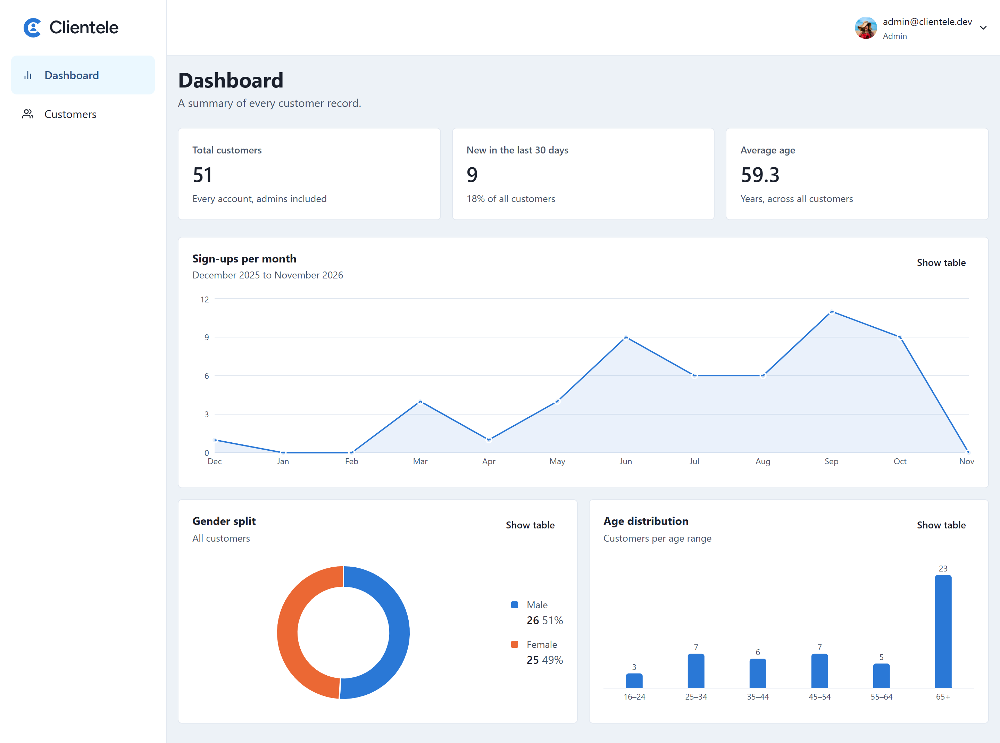
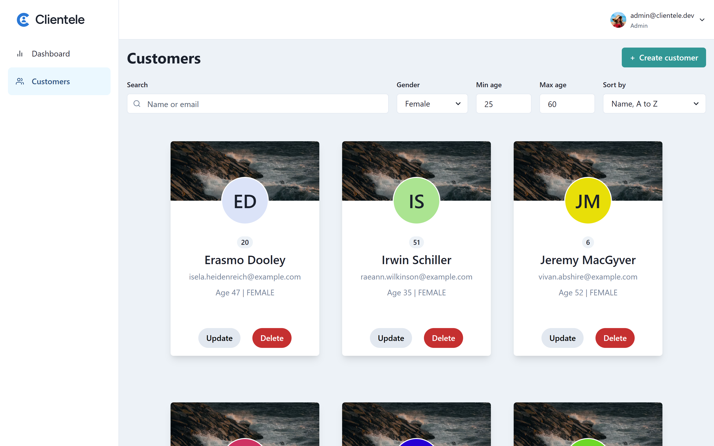
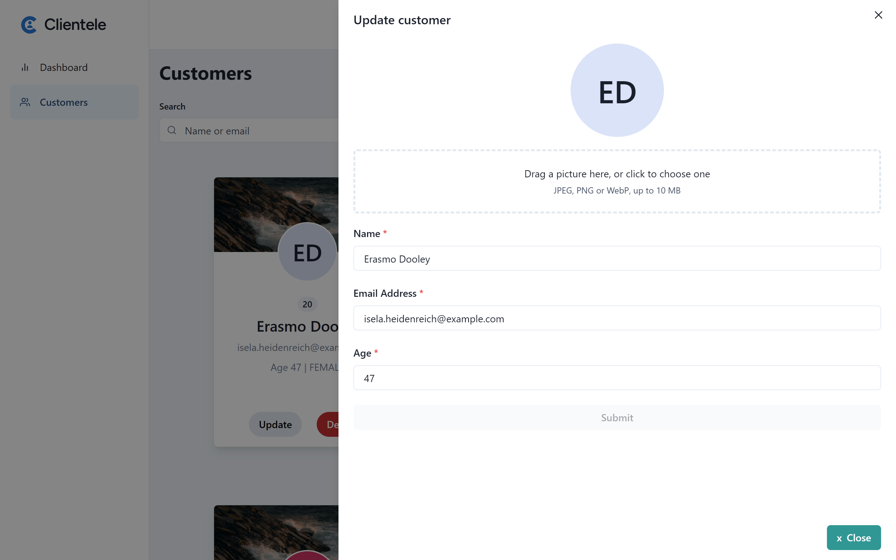
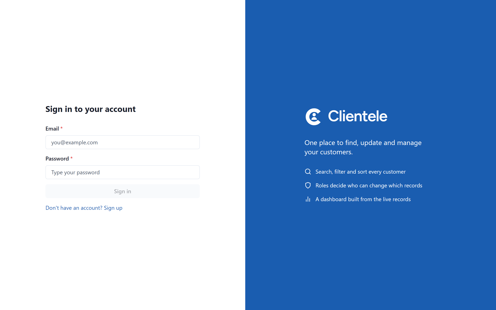
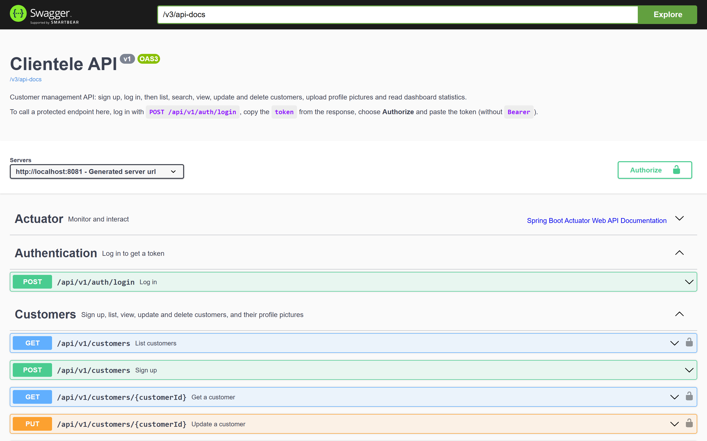
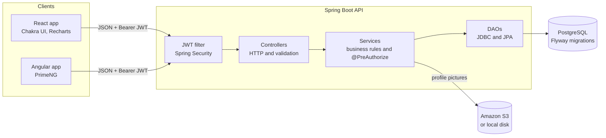

<p align="center">
  
</p>

<h1 align="center">Clientele</h1>

<p align="center">
  <strong>Customer management with role-based security, live analytics and a self-documenting REST API.</strong>
</p>

<p align="center">
  <a href="https://github.com/Rimaz17/clientele/actions/workflows/backend-ci.yml"></a>
  <a href="https://github.com/Rimaz17/clientele/actions/workflows/frontend-ci.yml"></a>
  <a href="https://github.com/Rimaz17/clientele/releases"></a>
  <br>
  
  
  
  
  
</p>

<p align="center">
  <a href="#try-it-in-five-minutes">Try it</a> ·
  <a href="#demo-accounts">Demo accounts</a> ·
  <a href="#api-documentation">API docs</a> ·
  <a href="docs/architecture.md">Architecture</a> ·
  <a href="docs/adr/">Design decisions</a>
</p>



Clientele is a full-stack platform for managing customer accounts. A stateless **Spring Boot 3** API, secured with JWTs and server-side ownership rules, serves a **React 18** app with a live analytics dashboard and a secondary **Angular 15** client. Every endpoint is described in an **OpenAPI** contract you can try in the browser, every schema change is a versioned **Flyway** migration, and **more than 400 automated tests** cover it from the SQL up to full HTTP journeys against a real PostgreSQL in Docker.

## Highlights

- **Authorization enforced on the server, not just hidden in the UI.** Accounts are `USER` or `ADMIN`. A method-level `@PreAuthorize` rule lets users change only their own account while admins can change any; everything else gets a `403`. Request bodies have no `role` or `id` fields, so sign-up can never grant privileges.
- **Analytics computed in SQL.** The dashboard's numbers come from four aggregate queries in one read-only `REPEATABLE READ` transaction, so no customer rows reach the application and the totals always agree.
- **Query design that holds up past a demo.** The customer list is paginated, searchable across name and email, filterable by gender and age, and sortable through a column whitelist. The React app keeps all of it in the URL, so refresh, the back button and shared links work.
- **Errors that mean something.** One exception handler maps domain errors to `400`, `401`, `403`, `404`, `409`, `413` and more, with a consistent JSON body. Validation failures list every bad field, and the React forms show them under the matching inputs.
- **A contract that cannot drift.** Swagger UI documents every endpoint with examples and a one-click JWT login, and an integration test fails the build if an endpoint ships without a summary.
- **No secrets in the code.** The JWT signing key comes from the environment, and outside local development the API refuses to start without one of at least 32 bytes.
- **Accessible by default.** The React app targets WCAG 2.2 AA: announced form errors, visible focus, AA contrast, and charts with screen reader summaries and table views.

## Screenshots

| Customers: search, filters, sorting and pagination | Editing a customer |
|---|---|
|  |  |
| **Sign in** | **Interactive API docs (Swagger UI)** |
|  |  |

## Try it in five minutes

You need **Java 17**, **Maven 3.9**, **Node 20** and **Docker Desktop** (running). The commands work in bash and in PowerShell.

```bash
git clone https://github.com/Rimaz17/clientele.git
cd clientele
docker compose up -d db
```

In a second terminal, start the API on `http://localhost:8080`. Flyway creates the schema, and no environment variables are needed locally:

```bash
cd backend
mvn spring-boot:run
```

In a third terminal, start the React app:

```bash
cd frontend/react
cp .env.example .env
npm ci
npm run dev
```

Open **http://localhost:5173** and sign in with a demo account below. The optional Angular app runs the same way from `frontend/angular` with `npm ci` and `npm start`, on port 4200.

### Demo accounts

Locally the API uses the `dev` profile, which creates an admin and 50 demo customers with a year of sign-up history.

| Sign in as | Email | Password | What to try |
|---|---|---|---|
| **Admin** | `admin@clientele.dev` | `admin-password` | Edit, delete or change the picture of any customer. Open the dashboard. |
| **Regular user** | any email from the customer list | `password` | Update and Delete appear only on your own card. Try changing someone else through Swagger UI and the API answers `403`. |
| **New user** | sign up on the sign-up page | your choice (4 to 15 characters) | Sign-up always creates a regular user. |

These accounts exist only in the local `dev` profile and are never valid anywhere else.

## Tech stack

| Area | Technology |
|---|---|
| Backend | Java 17, Spring Boot 3.0, Spring Security 6, JWT (jjwt), Bean Validation |
| Data | PostgreSQL 14, Flyway, Spring JDBC (`JdbcTemplate`), Spring Data JPA |
| Files | AWS SDK v2 for S3, with a local-disk fake for development |
| API docs | springdoc-openapi, Swagger UI |
| React app | React 18, Vite 4, Chakra UI, Recharts, Formik + Yup, Axios, React Router 6 |
| Angular app | Angular 15, PrimeNG |
| Tests | JUnit 5, Mockito, AssertJ, Testcontainers, WebTestClient, Vitest, React Testing Library |
| Delivery | Docker, docker-compose, Jib, GitHub Actions |

## Architecture



The API is organised by feature and layered strictly: controllers handle HTTP, services own business rules and authorization, and DAOs own SQL. The [architecture overview](docs/architecture.md) has the authentication and dashboard sequence diagrams.

## API documentation

With the API running, open Swagger UI at [http://localhost:8080/swagger-ui/index.html](http://localhost:8080/swagger-ui/index.html). The raw OpenAPI document is at `/v3/api-docs`. Neither needs a token.

To call a protected endpoint, sign in with `POST /api/v1/auth/login` (for example as the [demo admin](#demo-accounts)), copy the `token` from the response, and paste it into **Authorize** at the top of the page.

All endpoints live under `/api/v1`. The customer list takes query parameters for paging, sorting and filtering:

```
GET /api/v1/customers?page=0&size=20&sort=name,asc&search=ali&gender=FEMALE&minAge=18&maxAge=40
```

## Configuration

The `dev` profile needs no configuration. Any other profile, including the docker-compose API container, needs at least a JWT secret:

| Variable | Purpose |
|---|---|
| `CLIENTELE_JWT_SECRET` | Signs and verifies JWTs; at least 32 bytes (`openssl rand -base64 48`) |
| `CLIENTELE_BOOTSTRAP_ADMIN_EMAIL`, `CLIENTELE_BOOTSTRAP_ADMIN_PASSWORD` | Admin account created, or promoted, on startup |
| `SPRING_DATASOURCE_URL`, `SPRING_DATASOURCE_USERNAME`, `SPRING_DATASOURCE_PASSWORD` | Database connection |
| `VITE_API_BASE_URL` | Base URL of the API for the React app |

[`backend/.env.example`](backend/.env.example) lists every API variable with a placeholder. Copy it to `.env` next to `docker-compose.yml` and never commit `.env`.

## Running the tests

From the repository root, run each suite in its own terminal:

| Suite | Directory | Commands |
|---|---|---|
| API: unit, Testcontainers and integration tests (Docker must be running) | `backend` | `mvn -ntp verify` |
| React: lint, tests and build | `frontend/react` | `npm ci`, `npm run lint`, `npm test`, `npm run build` |
| Angular: build | `frontend/angular` | `npm ci`, `npm run build` |

GitHub Actions runs every suite on each pull request and on every merge to `main`.

## More documentation

- [Architecture overview](docs/architecture.md)
- [Architecture decision records](docs/adr/)
- [Changelog](CHANGELOG.md)
