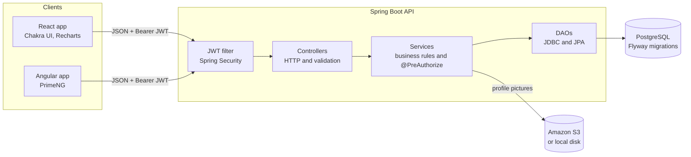

<p align="center">
  
</p>

<h1 align="center">Clientele</h1>

<p align="center">
  <strong>Customer management with role-based security, live analytics and a self-documenting REST API.</strong>
</p>

<p align="center">
  <a href="https://github.com/Rimaz17/clientele/actions/workflows/backend-ci.yml"></a>
  <a href="https://github.com/Rimaz17/clientele/actions/workflows/frontend-ci.yml"></a>
  <a href="https://github.com/Rimaz17/clientele/releases"></a>
  <br>
  
  
  
  
  
</p>

<p align="center">
  <a href="#try-it-in-five-minutes">Try it</a> ·
  <a href="#demo-accounts">Demo accounts</a> ·
  <a href="#api-documentation">API docs</a> ·
  <a href="docs/architecture.md">Architecture</a> ·
  <a href="docs/adr/">Design decisions</a>
</p>


Clientele is a full-stack platform for managing customer accounts. A stateless **Spring Boot 3** API, secured with JWTs and server-side ownership rules, serves a **React 18** app with a live analytics dashboard and a secondary **Angular 15** client. Every endpoint is described in an **OpenAPI** contract you can try in the browser, every schema change is a versioned **Flyway** migration, and **more than 400 automated tests** cover it from the SQL up to full HTTP journeys against a real PostgreSQL in Docker.

## Highlights

- **Authorization enforced on the server, not just hidden in the UI.** Accounts are `USER` or `ADMIN`. A method-level `@PreAuthorize` rule lets users change only their own account while admins can change any; everything else gets a `403`. Sign-up can never grant a role, because request bodies do not accept privilege fields.
- **Analytics computed in SQL.** The dashboard's numbers come from four aggregate queries in one read-only `REPEATABLE READ` transaction, so no customer rows reach the application and the totals always agree with each other.
- **Query design that holds up past a demo.** The customer list is paginated, searchable across name and email (with `%` and `_` escaped), filterable by gender and age, and sortable through a column whitelist with a stable tie-breaker. The React app keeps all of it in the URL, so refresh, the back button and shared links work.
- **Errors that mean something.** One exception handler maps domain errors to `400`, `401`, `403`, `404`, `405`, `409`, `413`, `415` and `500` with a consistent JSON body. Validation failures list every bad field, and the React forms show them under the matching inputs.
- **A contract that cannot drift.** Swagger UI documents every endpoint with examples, error codes and a one-click JWT login, and an integration test fails the build if an endpoint ships without a summary.
- **No secrets in the code.** The JWT signing key comes from the environment, and outside local development the API refuses to start without one of at least 32 bytes.
- **Accessible by default.** The React app targets WCAG 2.2 AA: labelled and announced form errors, visible focus, AA contrast, and charts with screen reader summaries and table views.

## Screenshots

| Customers: search, filters, sorting and pagination | Editing a customer |
|---|---|
|  |  |
| **Sign in** | **Interactive API docs (Swagger UI)** |
|  |  |

## Try it in five minutes

You need **Java 17**, **Maven 3.9**, **Node 20** and **Docker Desktop** (running). The commands below work as written in bash (macOS, Linux, Git Bash) and in PowerShell on Windows.

```bash
git clone https://github.com/Rimaz17/clientele.git
cd clientele
docker compose up -d db
```

In a second terminal, start the API on `http://localhost:8080`:

```bash
cd backend
mvn spring-boot:run
```

In a third terminal, start the React app:

```bash
cd frontend/react
cp .env.example .env
npm ci
npm run dev
```

Open **http://localhost:5173** and sign in with one of the demo accounts below. Swagger UI is at **http://localhost:8080/swagger-ui/index.html**.

### Demo accounts

When the API runs locally it uses the `dev` profile, which creates an admin and 50 demo customers with a year of sign-up history, so there is something to explore straight away.

| Sign in as | Email | Password | What to try |
|---|---|---|---|
| **Admin** | `admin@clientele.dev` | `admin-password` | Edit, delete or change the picture of any customer. Open the dashboard. |
| **Regular user** | any email from the customer list | `password` | You can browse everyone, but Update and Delete appear only on your own card. Try changing someone else through Swagger UI and the API answers `403`. |
| **New user** | sign up on the sign-up page | your choice (4 to 15 characters) | Sign-up always creates a regular user. |

These accounts exist only in the local `dev` profile. Any other environment has no admin until one is configured (see [Environment variables](#environment-variables)), and the dev credentials are never valid there.

## Features

### Accounts and security
- Sign up and sign in with email and password; passwords are stored as BCrypt hashes.
- Stateless JWT authentication with a configurable secret, issuer and lifetime.
- `USER` and `ADMIN` roles with ownership rules enforced by the API.
- Changing your own email returns a fresh token, so you stay signed in.
- Server-side validation of every request, mirrored by the client-side rules in React.

### Customer management
- Customer list with page numbers, page size, search, gender and age filters, and sorting by name, email, age or sign-up date.
- Create, update and delete customers, with confirmation before deleting and a toast for every outcome.
- Profile picture uploads (JPEG, PNG or WebP, up to 10 MB) stored in Amazon S3, or on the local disk during development. Customers without a picture show their initials.
- Distinct empty, loading and error states, including "no results" with a one-click "Clear filters".

### Dashboard
- Stat cards for total customers, new customers in the last 30 days and average age.
- Charts of monthly sign-ups over the last 12 months, the gender split and the age distribution.
- Loading placeholders, an error state with retry, and an accessible table view of every chart.

### API documentation
- Swagger UI and an OpenAPI 3 document, both public.
- Request and response examples and every error an endpoint can return.
- Protected endpoints can be called from the browser after pasting a token into **Authorize**.

## Tech stack

| Area | Technology |
|---|---|
| Backend | Java 17, Spring Boot 3.0, Spring Security 6, JWT (jjwt), Bean Validation |
| Data | PostgreSQL 14, Flyway, Spring JDBC (`JdbcTemplate`), Spring Data JPA |
| Files | AWS SDK v2 for S3, with a local-disk fake for development |
| API docs | springdoc-openapi, Swagger UI |
| React app | React 18, Vite 4, Chakra UI, Recharts, Formik + Yup, Axios, React Router 6 |
| Angular app | Angular 15, PrimeNG |
| Tests | JUnit 5, Mockito, AssertJ, Testcontainers, WebTestClient, Vitest, React Testing Library |
| Delivery | Docker, docker-compose, Jib, GitHub Actions |

## Architecture



The API is organised by feature (`auth`, `customer`, `stats`, `jwt`, `security`, `s3`, `bootstrap`, `openapi`, `exception`) and layered strictly: controllers handle HTTP, services own business rules and authorization, and DAOs own SQL. The [architecture overview](docs/architecture.md) has the authentication and dashboard sequence diagrams.

## Security model

| Concern | How Clientele handles it |
|---|---|
| Authentication | `POST /api/v1/auth/login` returns an HS256-signed JWT. Every protected request sends it as `Authorization: Bearer <token>`; the API keeps no session. |
| Token checks | Signature, expiry and issuer are verified, and the user must still exist. A missing or invalid token gets `403`. |
| Roles | Stored in the `customer.role` column, exposed as `ROLE_USER` or `ROLE_ADMIN` and carried in the token's `scopes` claim. |
| Ownership | `@PreAuthorize("hasRole('ADMIN') or @customerAccess.isSelf(...)")` on update, delete and picture upload. Reading the list is open to every signed-in user. |
| Mass assignment | Request records have no `id` or `role` fields, so a client cannot grant itself privileges. |
| Validation | `@Valid` request records with `@Email`, `@NotBlank`, `@Size` and `@Min`/`@Max`; query parameters and uploads are validated too. |
| Secrets | The JWT secret comes from `CLIENTELE_JWT_SECRET`. Only the local `dev` profile has a built-in development secret. |
| Error responses | Generic messages for unexpected errors; stack traces and internals stay in the server log. |

The reasoning behind each choice is in the [design decisions](#design-decisions).

## Getting started in detail

### Prerequisites

| Tool | Version | Used for |
|---|---|---|
| Java | 17 | The API |
| Maven | 3.9 | Building and testing the API |
| Node.js | 20 (18 for the Angular app) | The frontends |
| Docker Desktop | any recent version, running | PostgreSQL and the Testcontainers tests |

### 1. Database

From the repository root:

```bash
docker compose up -d db
```

PostgreSQL listens on `localhost:5332` and creates the `customer` database the first time its volume is created. If you have a volume from an older version of the project that has no `customer` database, create it once:

```bash
docker exec postgres psql -U amigoscode -c "CREATE DATABASE customer;"
```

### 2. API

```bash
cd backend
mvn spring-boot:run
```

The API starts on `http://localhost:8080`, Flyway applies the migrations, and the `dev` profile (the default) adds the demo data. No environment variables are needed for local development.

### 3. React app (primary UI)

```bash
cd frontend/react
cp .env.example .env
npm ci
npm run dev
```

Open `http://localhost:5173`. `VITE_API_BASE_URL` in `.env` points the app at the API.

### 4. Angular app (optional)

```bash
cd frontend/angular
npm ci
npm start
```

Open `http://localhost:4200`. It uses the same API and the same demo accounts.

### Running the API outside the dev profile

Any other profile, including the docker-compose API container and the AWS deployment, needs a JWT signing secret of at least 32 bytes, or the API refuses to start and names the missing property. Generate one with:

```bash
openssl rand -base64 48
```

Set it in bash:

```bash
export CLIENTELE_JWT_SECRET="<generated value>"
```

Set it in PowerShell:

```powershell
$env:CLIENTELE_JWT_SECRET = "<generated value>"
```

For docker-compose you can instead copy `backend/.env.example` to `.env` in the repository root, next to `docker-compose.yml`, and replace the placeholders. Never commit `.env`. For the AWS deployment, set the variables as environment properties of the Elastic Beanstalk environment.

## Environment variables

### API

| Variable | Default | Purpose |
|---|---|---|
| `SPRING_DATASOURCE_URL` | `jdbc:postgresql://localhost:5332/customer` | Database connection |
| `SPRING_DATASOURCE_USERNAME`, `SPRING_DATASOURCE_PASSWORD` | match `docker-compose.yml` | Database credentials |
| `CLIENTELE_JWT_SECRET` | none (`dev` profile: a built-in development secret) | Signs and verifies JWTs; at least 32 bytes |
| `CLIENTELE_JWT_EXPIRATION` | `15d` | Token lifetime |
| `CLIENTELE_JWT_ISSUER` | `clientele` | `iss` claim written to and required on tokens |
| `CLIENTELE_BOOTSTRAP_ADMIN_EMAIL` | none (`dev` profile: `admin@clientele.dev`) | Admin account created, or promoted, on startup |
| `CLIENTELE_BOOTSTRAP_ADMIN_PASSWORD` | none (`dev` profile: `admin-password`) | Its password, at least 8 characters |
| `SPRINGDOC_SWAGGERUI_ENABLED` | `true` | Set to `false` to turn Swagger UI off; `/v3/api-docs` stays available |

When both admin variables are set, startup creates that admin, or promotes the existing account with that email and sets its password to the configured value ([ADR 0005](docs/adr/0005-role-based-access-and-ownership.md)). [`backend/.env.example`](backend/.env.example) lists every variable with a placeholder.

### React app

| Variable | Default | Purpose |
|---|---|---|
| `VITE_API_BASE_URL` | `http://localhost:8080` in `.env.example` | Base URL of the API |

## Running the tests

```bash
# API: unit, Testcontainers and integration tests (Docker must be running)
cd backend
mvn -ntp verify
```

```bash
# React: lint, tests and production build
cd frontend/react
npm ci
npm run lint
npm test
npm run build
```

```bash
# Angular: production build
cd frontend/angular
npm ci
npm run build
```

| Suite | What it covers |
|---|---|
| API unit tests | Services, authorization rules, validation, JWT handling, error mapping |
| Testcontainers tests | Both DAO implementations and every SQL query against a throwaway PostgreSQL |
| API integration tests (`*IT`) | Full HTTP journeys: sign-up, login, roles and ownership, pagination, stats, error codes, API docs |
| React tests | Components, hooks and pages with Vitest and React Testing Library |

GitHub Actions runs all of them on every pull request and on every merge to `main`.

## API documentation

With the API running, open Swagger UI at [http://localhost:8080/swagger-ui/index.html](http://localhost:8080/swagger-ui/index.html). The raw OpenAPI document is at `http://localhost:8080/v3/api-docs`. Neither needs a token.

To call a protected endpoint from Swagger UI:

1. Open **Authentication**, choose `POST /api/v1/auth/login`, then **Try it out**, and sign in, for example as the [demo admin](#demo-accounts).
2. Copy the `token` value from the response.
3. Choose **Authorize** at the top of the page, paste the token without the `Bearer ` prefix, and confirm.
4. Protected endpoints, marked with a lock, now send the token.

All endpoints live under `/api/v1`. Everything except sign-up (`POST /customers`), login (`POST /auth/login`) and profile-picture downloads needs a token.

### Listing customers

```
GET /api/v1/customers?page=0&size=20&sort=name,asc&search=ali&gender=FEMALE&minAge=18&maxAge=40
```

| Parameter | Rules | Default |
|---|---|---|
| `page` | 0 or more | `0` |
| `size` | 1 to 100 | `20` |
| `sort` | `id`, `name`, `email`, `age` or `createdAt`, optionally followed by `,asc` or `,desc` | `createdAt,desc` |
| `search` | matches name or email, ignoring case; at most 100 characters | none |
| `gender` | `MALE` or `FEMALE` | none |
| `minAge`, `maxAge` | 16 to 100, inclusive; `minAge` must not be greater than `maxAge` | none |

The response is `{ "content": [...], "page": 0, "size": 20, "totalElements": 132, "totalPages": 7 }`. Invalid parameters return `400` with an `errors` list. Each customer includes `createdAt`, the sign-up time in UTC.

### Dashboard statistics

```
GET /api/v1/customers/stats
```

```json
{
  "totalCustomers": 132,
  "newLast30Days": 14,
  "averageAge": 37.4,
  "genderSplit": { "MALE": 70, "FEMALE": 62 },
  "ageDistribution": [
    { "range": "16-24", "count": 20 },
    { "range": "25-34", "count": 41 },
    { "range": "35-44", "count": 33 },
    { "range": "45-54", "count": 19 },
    { "range": "55-64", "count": 12 },
    { "range": "65+", "count": 7 }
  ],
  "signupsByMonth": [
    { "month": "2025-11", "count": 8 },
    { "month": "2025-12", "count": 5 }
  ]
}
```

`signupsByMonth` always has 12 entries, the current UTC month and the 11 before it, oldest first (shortened above). `averageAge` is `null` when there are no customers. Every gender, age range and month is present, with `0` when empty.

### Errors

Every error uses the same body. Validation failures add an `errors` list:

```json
{
  "path": "/api/v1/customers",
  "message": "Request validation failed",
  "statusCode": 400,
  "localDateTime": "2026-11-02T10:15:30",
  "errors": [
    { "field": "email", "message": "Email must be a valid email address" }
  ]
}
```

## Project structure

```
clientele/
├── backend/                     Spring Boot API (Maven)
│   └── src/main/
│       ├── java/dev/rimaz/clientele/
│       │   ├── auth/            login endpoint and service
│       │   ├── bootstrap/       admin bootstrap and dev demo data
│       │   ├── customer/        customer endpoints, service, JDBC and JPA DAOs
│       │   ├── exception/       domain exceptions and the global handler
│       │   ├── jwt/             token creation, validation and properties
│       │   ├── openapi/         OpenAPI configuration
│       │   ├── s3/              profile picture storage
│       │   ├── security/        filter chain and ownership checks
│       │   └── stats/           dashboard statistics
│       └── resources/db/migration/   Flyway migrations V1 to V4
├── frontend/
│   ├── react/                   primary UI (Vite, Chakra UI)
│   └── angular/                 secondary UI (PrimeNG)
├── docs/
│   ├── architecture.md          system and sequence diagrams
│   ├── adr/                     architecture decision records
│   └── screenshots/
├── .github/workflows/           CI for the API and both frontends, manual CD
└── docker-compose.yml           PostgreSQL, API and React containers
```

## Design decisions

Each significant decision is recorded as an architecture decision record with its context, alternatives and consequences:

| ADR | Decision |
|---|---|
| [0002](docs/adr/0002-error-handling-strategy.md) | Domain exceptions mapped to HTTP status codes in one handler |
| [0003](docs/adr/0003-input-validation.md) | Bean Validation at the API boundary, mirrored in the React forms |
| [0004](docs/adr/0004-externalized-jwt-secret.md) | JWT secret from the environment, with a fail-fast startup check |
| [0005](docs/adr/0005-role-based-access-and-ownership.md) | `USER` and `ADMIN` roles with method-level ownership checks |
| [0006](docs/adr/0006-offset-pagination-and-search.md) | Offset pagination, search and whitelisted sorting for the customer list |
| [0007](docs/adr/0007-dashboard-aggregations.md) | Dashboard statistics as SQL aggregations in one transaction |

## Known limitations and roadmap

Known limitations:

- Profile-picture downloads are public, because `` tags cannot send a token. Picture ids are random UUIDs, so they cannot be guessed.
- Profile pictures are always served as `image/jpeg`, and replaced pictures are not deleted from S3.
- Role changes show in the UI after the next sign-in, because the frontends read the role from the token.
- Passwords are limited to 15 characters.
- The Angular app covers the original features only; pagination controls, picture uploads and the dashboard are React-only.

Roadmap:

- Refresh tokens and server-side sign-out
- Password reset and email verification
- Rate limiting on sign-in
- CORS restricted to known origins
- Role management endpoints for admins
- A live deployment with Playwright end-to-end tests

## More documentation

- [Architecture overview](docs/architecture.md)
- [Architecture decision records](docs/adr/)
- [Changelog](CHANGELOG.md)
