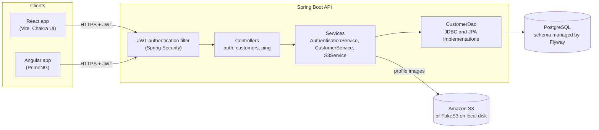
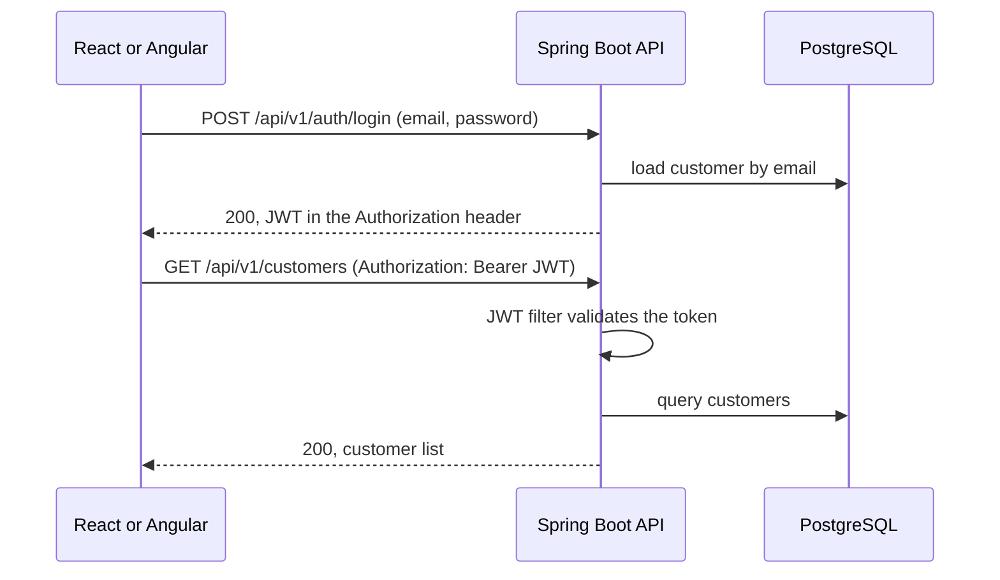

# Architecture

Clientele is a single Spring Boot REST API with two browser clients. The API is stateless: every protected request carries a JWT in the `Authorization` header.

## System overview

## Layers

The backend is an N-tier application, organised by feature package (`auth`, `customer`, `exception`, `jwt`, `s3`, `security`).

| Layer | Responsibility |
|---|---|
| Security filter chain | `JWTAuthenticationFilter` validates the bearer token and sets the authenticated user. Public endpoints are registration, login, `/ping`, profile-image downloads and actuator health. |
| Controllers | HTTP only: request mapping, status codes and response headers. |
| Services | Business rules, such as duplicate email checks and update validation. |
| DAO | `CustomerDao` hides persistence. `CustomerService` uses the JDBC implementation (`JdbcTemplate`); authentication uses the JPA implementation (Spring Data `CustomerRepository`). |
| Database | PostgreSQL. Flyway owns the schema, and Hibernate only validates it. |
| File storage | `S3Service` stores profile images in S3. When `aws.s3.mock` is `true`, `FakeS3` writes them to the local disk instead. |

Errors are thrown as domain exceptions and turned into `ApiError` responses in one place, `DefaultExceptionHandler`.

## Authentication flow

Tokens are signed with HS256 using the secret in `clientele.jwt.secret` and carry the configured issuer and expiry (`JwtProperties`). The `dev` profile, active by default, supplies a development-only secret; every other environment sets `CLIENTELE_JWT_SECRET` or the API does not start. An invalid, expired or foreign token leaves the request unauthenticated, so protected endpoints answer 403.

## Deployment

The backend image is built with Jib and the React image with its Dockerfile. `docker-compose.yml` runs PostgreSQL, the API and the React app together. `Dockerrun.aws.json` describes an Elastic Beanstalk deployment; the deployment workflow only runs when triggered manually.
